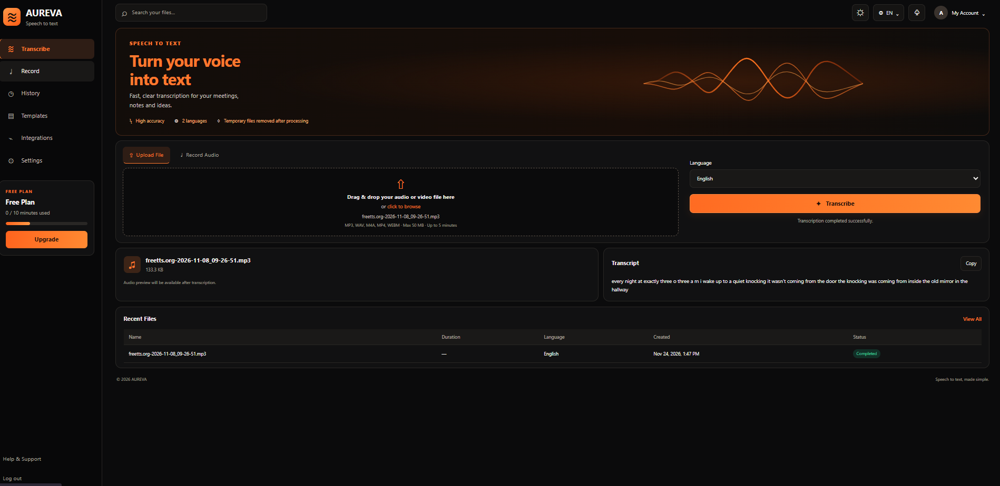

# Aureva — Speech to Text (MVP)

Web application that transcribes audio and video files into text. Built as an MVP together with a full **QA automation suite** (UI + API tests).

> **Status:** MVP. See [Known issues & Roadmap](#known-issues--roadmap).




## Features

- Upload an audio/video file (MP3, WAV, M4A, MP4, WEBM) and get a transcript
- Languages: English and Russian
- Offline recognition with [Vosk](https://alphacephei.com/vosk/) (no external API, no API keys)
- Transcription history stored in PostgreSQL (view and delete records)
- Uploaded media is processed in a temporary folder that is removed after processing, even if an error occurs
- Validation: file size (max 50 MB), duration (max 5 minutes, checked in the browser and on the server), file format, file name, language, empty files

> **Privacy note:** audio files are not kept, but the resulting transcripts and file names are stored in the database (history). Use the history page to delete them.

## Tech stack

| Area | Tools |
|------|-------|
| Backend | Java 21, Spring Boot 4, Spring Data JPA, Thymeleaf |
| Database | PostgreSQL, Flyway migrations |
| Speech recognition | Vosk, FFmpeg (audio conversion) |
| Frontend | HTML, CSS, vanilla JavaScript |
| UI tests | Playwright (Java), TestNG |
| API tests | REST Assured, TestNG |
| Reporting | Allure |

## Requirements

- JDK 21
- Maven (or the included `mvnw`)
- PostgreSQL
- [FFmpeg](https://ffmpeg.org/download.html) available in `PATH` (or set `FFMPEG_PATH`)
- Vosk models (not included in the repository because of their size)

## Setup

### 1. Database

Create an empty database. Tables are created automatically by Flyway on first start.

```sql
CREATE DATABASE aureva;
```

### 2. Vosk models

Download the models from <https://alphacephei.com/vosk/models> and unpack them into a `models/` folder in the project root:

```
models/
├── vosk-model-en-us-0.22/
└── vosk-model-ru-0.42/
```

Smaller models (e.g. `vosk-model-small-*`) also work and are much lighter, but are less accurate. If you use different folders, set `VOSK_MODEL_EN` / `VOSK_MODEL_RU`.

### 3. Environment variables

| Variable | Default | Description |
|----------|---------|-------------|
| `DB_URL` | `jdbc:postgresql://localhost:5432/aureva` | JDBC URL |
| `DB_USERNAME` | `postgres` | Database user |
| `DB_PASSWORD` | *(empty)* | Database password |
| `FFMPEG_PATH` | `ffmpeg` | Path to the FFmpeg executable |
| `VOSK_MODEL_EN` | `models/vosk-model-en-us-0.22` | English model path |
| `VOSK_MODEL_RU` | `models/vosk-model-ru-0.42` | Russian model path |
| `TRANSCRIPTION_ENGINE` | `vosk` | Recognition engine |
| `TRANSCRIPTION_LANGUAGE` | `en` | Default language |

Example (Windows PowerShell):

```powershell
$env:DB_PASSWORD = "your_password"
```

Example (Linux / macOS):

```bash
export DB_PASSWORD=your_password
```

### 4. Run

```bash
./mvnw spring-boot:run
```

Open <http://localhost:8080>.

## API

| Method | Endpoint | Description |
|--------|----------|-------------|
| `POST` | `/api/uploads` | Upload a file (`multipart/form-data`: `file`, `language` = `en` \| `ru`) and get the transcript |
| `GET` | `/api/history` | List transcription history (newest first) |
| `DELETE` | `/api/history/{id}` | Delete one record (`204`, or `404` if it does not exist) |
| `DELETE` | `/api/history/selected` | Delete records by a JSON array of ids, e.g. `[1, 2]` (`204`; `400` for an empty list; `404` and nothing deleted if any id does not exist) |
| `DELETE` | `/api/history` | Delete all records |

Upload errors are returned as `{"error": "..."}` with status `400` (validation, audio longer than 5 minutes), `413` (file too large) or `422` (audio could not be processed).

## Tests

The test suite lives in `src/test/java/.../tests` and follows the Page Object pattern:

```
tests/
├── api/      # REST Assured tests + API clients (upload, history)
├── ui/       # Playwright tests (home page, history page)
├── pages/    # Page Objects
├── base/     # Browser setup, screenshot on failure, test data cleanup
├── config/   # Test configuration (base URL)
└── utils/    # Test audio helpers, transcript language checks
```

Coverage includes: page rendering, language switching, successful EN/RU transcription (the transcript language is verified), validation of empty / unsupported / oversized / corrupted files, file name rules (too long, path stripping), audio longer than 5 minutes (UI and API), button states and error messages, and the full history API (list, delete one, delete selected, delete all).

**Important:** tests run against a live application. Start the app first (PostgreSQL, FFmpeg and the Vosk models must be configured), then in another terminal:

```bash
./mvnw test
```

The first run of Playwright downloads browsers automatically.

### Test options

| Option | Default | Description |
|--------|---------|-------------|
| `-Dbase.url=...` | `http://localhost:8080` | Address of the running application |
| `-Dtests.allow.destructive=true` | off | Enables the "delete all history" test. It wipes the **whole** history, so use it only on a disposable database. Without it the test is skipped. |

Tests create their own data and, after the run, remove the history records they added. Records that existed before the run are not touched.

### Allure report

Screenshots of failed UI tests are saved to `target/screenshots`.

```bash
allure serve target/allure-results
```

(requires the [Allure CLI](https://allurereport.org/docs/install/))

## Known issues & Roadmap

- Recording duration is not stored, so the "Duration" column in the history table always shows "—"
- "Free Plan" / "Upgrade" and the minutes counter are UI placeholders (no billing or usage limits implemented)
- Templates and Integrations in the sidebar are placeholders: clicking them does nothing yet (no page and no "coming soon" message)
- Account, authentication and support actions are not implemented yet
- No authentication
- The history endpoint returns all records without pagination
- Planned: other recognition engines, more languages, duration in history, CI pipeline (GitHub Actions)
- The language is not detected automatically: if the selected language does not match the recording (in either direction), the result is meaningless text and the app still reports success (Vosk limitation)

## License

This project is licensed under the [MIT License](LICENSE).

## Author

Created by [malikrahimov16](https://github.com/malikrahimov16).
